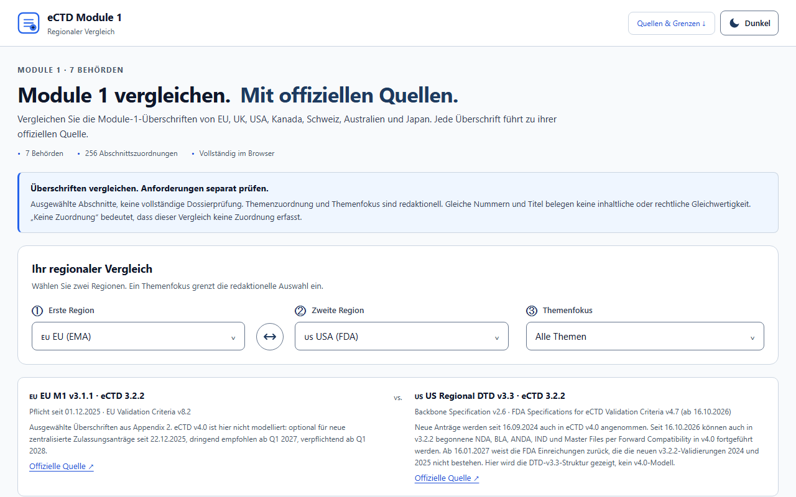
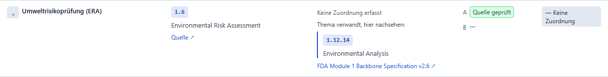
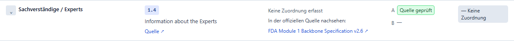
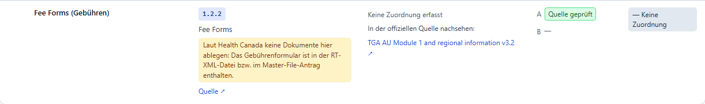
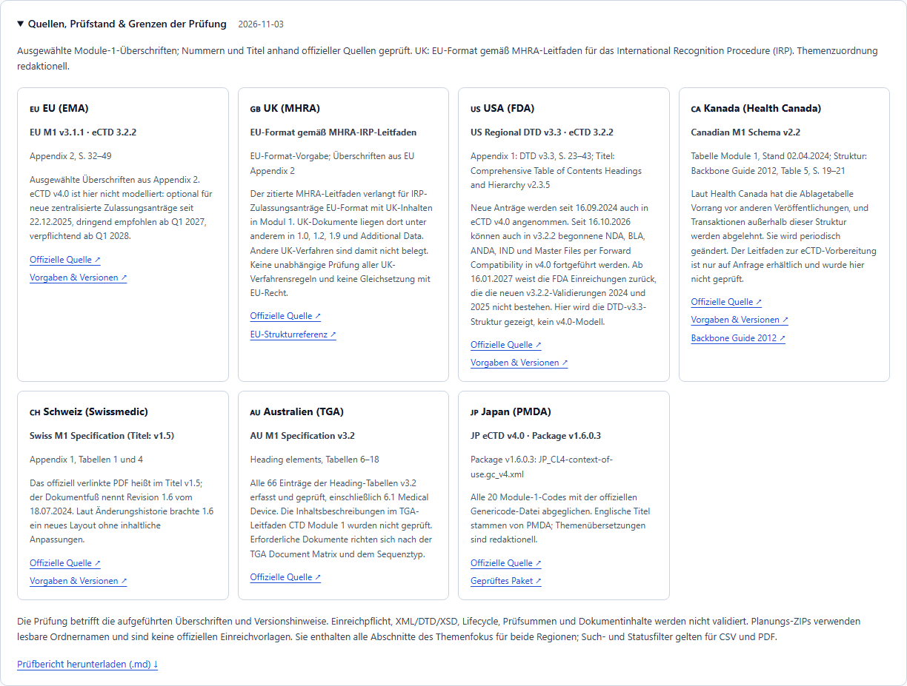
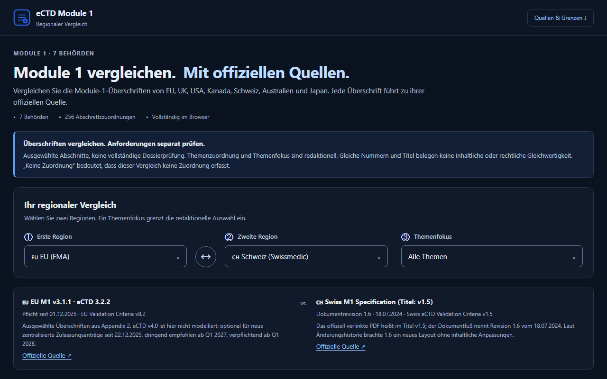
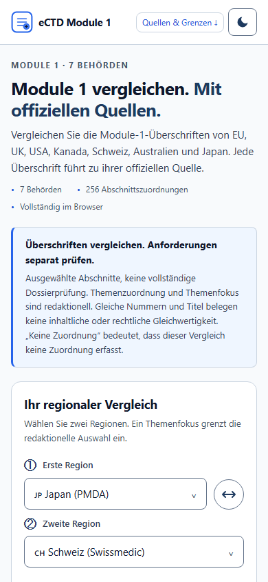

# eCTD Module 1 Comparison

| Document field | Value |
|---|---|
| Application version | 8.2.0 |
| Dataset version | 2026.11.03-3 |
| Source validation date | 3 November 2026 |
| Status | Reference tool. Source validation has not had independent review |
| Regions | European Union, United Kingdom, United States, Canada, Switzerland, Australia and Japan |
| Website | https://yasssssssserrr.github.io/eCTD-Module1-Checker/ |
| Source code | https://github.com/yasssssssserrr/eCTD-Module1-Checker |
| Product owner | To be assigned |
| Regulatory data owner | To be assigned |
| Technical owner | To be assigned |

> The tool helps people find and compare Module 1 headings. It does not check dossiers, and it does not say which documents a submission must contain.

## 1. Purpose

Module 1 is region-specific, so the same topic can have a different number or title in each region. This tool shows two regions side by side, links to the official source for each heading, and points to where a topic may be found when a region has no direct mapping.

It helps Regulatory Affairs, Regulatory Operations and publishing teams with first orientation, gap discussions and planning.

The EU dossier check that versions 7.0 and 7.1 included was removed in 8.0.0, because the goal is the Module 1 comparison. Its last version is commit `2ad23ce` in Git.

## 2. How to use it



1. Open the website and choose two regions.
2. Optionally choose a topic focus.
3. Read the summary for each region, including its version and limits.
4. Use the search box or the status filters to narrow the table.
5. Open a heading's **Quelle** link to read the official source.
6. Export the view as CSV or PDF, or download the planning ZIP.

The address bar keeps the selected regions, focus, search and filter, so **Link kopieren** shares the exact view.

### Reading the table

| Status | Meaning |
|---|---|
| **Nr. & Titel gleich** | Both regions record the same number and title. The content or requirement can still differ. |
| **Abweichend** | Both regions have the topic, with a different number or title. |
| **Keine Zuordnung** | Only one region has a direct mapping in this dataset. This does not mean that the other region has no such content. |

| Evidence label | Meaning |
|---|---|
| **Quelle geprüft** | Number and title were checked against the cited authority source. |
| **Formatreferenz** | UK only. The heading comes from the EU structure, as the MHRA guidance requires for International Recognition Procedure applications. |

### When a region has no mapping

If the topic is related to a heading in that region, the table shows where to look:



Otherwise it links to that region's official source:



Pointers are editorial. They show where to look and do not establish equivalent content or requirements. Search also finds them, and the CSV export lists them in their own columns.

### Authority restrictions

Some headings carry a restriction from the authority, shown beside the title. For example, Health Canada says not to place documents in 1.2.2 Fee Forms:



### Sources and limits

The **Quellen, Prüfstand & Grenzen der Prüfung** panel lists the source, location and limits for each region:



### Display options

The site opens in light mode on every device. The sun/moon button in the header, labelled Hell or Dunkel on larger screens, switches to the other theme, and the browser remembers that choice. The site also works on phones. In a narrow window, the table scrolls sideways inside its own area.

| Dark mode | Phone |
|---|---|
|  |  |

### Exports

| Export | Contents |
|---|---|
| CSV | The filtered rows with numbers, titles, source links, locations, review status, pointers, dataset date and disclaimer |
| PDF | The browser's print view of the filtered rows |
| Planning ZIP | Empty folders with readable names and a notice. These are **not** official eCTD submission paths |

## 3. Content

| Region | Authority | Reference used | Headings |
|---|---|---|---|
| EU | EMA | EU M1 v3.1.1, eCTD 3.2.2; criteria v8.2, mandatory since 1 December 2025 | 32 |
| UK | MHRA | EU format as required by the IRP guidance, updated 9 October 2026 | 32 |
| US | FDA | Regional DTD v3.3, specification v2.6, heading list v2.3.5; criteria v4.7 | 35 selected |
| Canada | Health Canada | Placement table of 2 April 2024, Schema v2.2; validation rules v5.3 | 35 selected |
| Switzerland | Swissmedic | Swiss M1 specification v1.5, revision 1.6; criteria v1.5 | 36 selected |
| Australia | TGA | AU M1 v3.2, effective 1 April 2025; criteria v3.2 | 66, all |
| Japan | PMDA | eCTD v4.0 package v1.6.0.3, JP CV 2026-06 | 20, all |

There are 256 headings in 166 rows, and 130 pointers for regions without a mapping.

Coming changes that users should know about:

- **EU:** eCTD v4.0 is optional for new centrally authorised applications since 22 December 2025, strongly recommended from Q1 2027 and mandatory from Q1 2028.
- **US:** forward compatibility to eCTD v4.0 has been supported since 16 October 2026. From 16 January 2027, FDA rejects submissions that fail the new high-severity validations 2024 and 2025.

This tool shows eCTD 3.2.2 structures, except for Japan, whose headings come from its v4.0 package.

## 4. Source validation

On 3 November 2026, every heading and pointer was compared with text from the authority sources, and section descriptions and notices were read as well. No difference remains. The full record is in [VALIDATION_REPORT.md](VALIDATION_REPORT.md).

Main corrections from this validation:

- Canada: added the Health Canada placement restrictions, such as no documents in 1.2.2 and 1.5, and made the placement table the primary source.
- Japan: added the eight 1.13 codes.
- Australia: added 6.1 Medical Device.
- EU and FDA: corrected source page numbers.
- FDA: added the January 2027 rejection date.

Not verified:

- The TGA CTD Module 1 guidance could not be downloaded, so Australian section content and pointers are not verified.
- The Health Canada eCTD preparation guidance is available only on request.
- PMDA's Japanese documents were only partly read.
- The grouping of topics across regions is editorial, and nobody has independently reviewed it.
- The US, Canada and Switzerland cover selected headings only.

## 5. Keeping the content current

Authority sources change without notice from this tool, so the regulatory data owner should:

1. Check each authority's source at least quarterly and when an authority announces a change.
2. Update only the affected records in `data.js`, with the source and its location.
3. Update `DATASET_META.version` and `lastReviewedAt`, and record the change in `VALIDATION_REPORT.md`.
4. Run the tests, have a regulatory reviewer check the change, and open a pull request.

Health Canada's placement table in particular changes periodically, and Health Canada makes sponsors responsible for watching it.

| Watch | Source |
|---|---|
| EU | [EMA eCTD M1 page](https://esubmission.ema.europa.eu/eumodule1/index.htm), [EMA eCTD v4.0 page](https://esubmission.ema.europa.eu/eCTD%20NMV/eCTD.html) |
| UK | [MHRA eCTD guidance](https://www.gov.uk/government/publications/international-recognition-procedure/ectd-guidance-for-irp-mas-and-lifecycle) |
| US | [FDA eCTD page](https://www.fda.gov/drugs/electronic-regulatory-submission-and-review/electronic-common-technical-document-ectd) |
| Canada | [Filing submissions electronically](https://www.canada.ca/en/health-canada/services/drugs-health-products/drug-products/applications-submissions/guidance-documents/filing-submissions-electronically.html) |
| Switzerland | [Swissmedic eCTD page](https://www.swissmedic.ch/swissmedic/en/home/services/submissions/ectd.html) |
| Australia | [TGA AU Module 1 v3.2](https://www.tga.gov.au/resources/resources/user-guide/ectd-au-module-1-and-regional-information-v32) |
| Japan | [PMDA package page](https://www.pmda.go.jp/int-activities/int-harmony/ich/0092.html) |

## 6. Technical overview

The site is static, with no backend and no runtime dependencies. All comparison work happens in the browser.

| File | Responsibility |
|---|---|
| `index.html` | Page structure and Content Security Policy |
| `core.js` | Comparison, filtering, data validation, folder paths and CSV |
| `data.js` | Regions, headings, pointers and dataset metadata |
| `zip.js` | Planning ZIP creation |
| `app.js` | Interface, state and exports |
| `theme.js` | Light/dark switch and remembering the choice |
| `style.css` | Themes, responsive layout and print rules |
| `tests/` | Reference tests and browser tests |
| `scripts/` | Build, local server and documentation screenshots |

The app checks its own data when it starts and refuses to show results if it finds structural errors, such as duplicate numbers or a pointer that conflicts with a recorded heading.

**Privacy and security:** the site has no login, uploads or cookies. It stores only the chosen theme in the browser, under `ectd-theme`, and nothing else. Its security policy allows resources only from its own origin. Search terms and selections appear in the page address, so shared links reveal them. Opening a source link connects to that authority's website.

**Publishing:** GitHub Pages publishes from `master` after the tests pass. Pull requests run the tests without publishing.

### Develop and test

Use Node.js 24 or later:

```sh
npm ci
npm run check
npx playwright install chromium
npm run build
npm run test:browser
npm start
```

To refresh the screenshots in this document, run `npm start` in one terminal and `node scripts/capture-doc-screenshots.js` in another.

On Windows, `npm run test:browser` has stalled after finishing. If that happens, run `npm start` separately and set `ECTD_TEST_URL=http://127.0.0.1:4173/` before running the tests.

## 7. Limitations

| Limitation | Effect | What to do |
|---|---|---|
| Content is maintained by hand | It can become outdated | Check the dataset date and confirm against the authority source |
| No requirement assessment | The tool does not say what a submission must contain | Use authority guidance and regulatory judgement |
| Selected headings for US, Canada and Switzerland | Some headings are not shown | Use the official source link |
| Editorial topic groups and pointers | They can be incomplete or debatable | Treat them as a place to start, and have them reviewed |
| No eCTD v4.0 model | EU and US v4.0 structures are not shown | Use the authority's v4.0 documents |
| Public website with no access control | Anyone with the link can open it | Do not put confidential content in search terms or shared links |
| No audit trail or approval workflow | Exports are not controlled records | Store approved outputs in your document system |

## 8. Ownership

Before wider use, these roles need to be assigned:

| Role | Responsibility | Assigned to |
|---|---|---|
| Product owner | Scope and priorities | To be assigned |
| Regulatory data owner | Accuracy, review cycle and interpretation | To be assigned |
| Regulatory reviewer | Independent review of validation and pointers | To be assigned |
| Technical owner | Code, hosting and security | To be assigned |

## 9. Glossary

| Term | Meaning |
|---|---|
| eCTD | Electronic Common Technical Document |
| Module 1 | Region-specific administrative and product information |
| IRP | International Recognition Procedure (UK) |
| DTD | Document Type Definition, which defines an XML structure |
| NDA, BLA, ANDA, IND | US application types |
| RMP, REMS | Risk Management Plan; Risk Evaluation and Mitigation Strategy |

## 10. Disclaimer

This is a reference and planning aid. It is not an authority system, a dossier validator or a replacement for current official guidance and qualified regulatory judgement. Users must confirm requirements against the latest authority sources.
